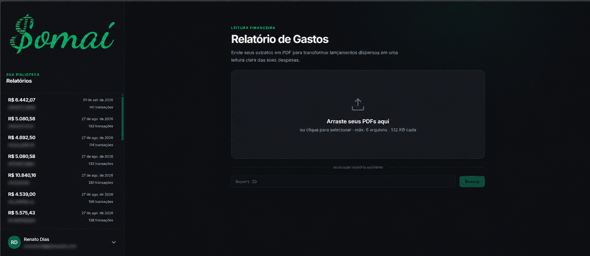
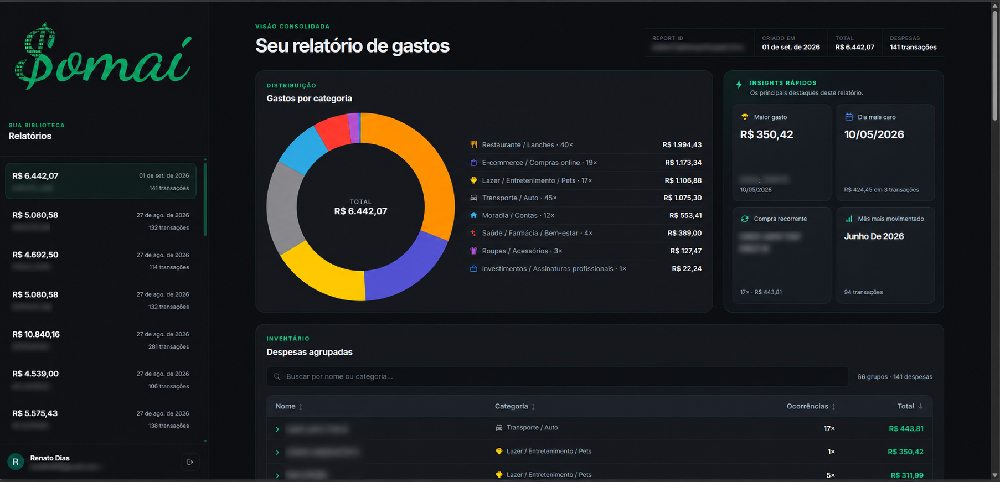
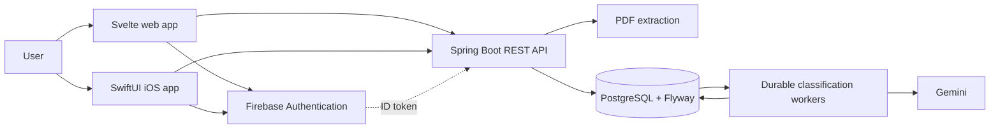

  

<h1 align="center">Somai</h1>

  <strong>From raw expense PDFs to a clear, private picture of where the money went.</strong>

  

Somai is a web and iOS product for people who want useful spending insights without manually cleaning statements or building spreadsheets. A user uploads expense PDFs; Somai extracts and normalizes the transactions, classifies them with AI, and turns them into account-private reports with charts, highlights, grouped expenses, history, and CSV export.

**[Open the web experience](https://somai.renatoxico.net)** · **[Explore the iOS app](https://github.com/Renatoxico/extReader)**

## Product experience

### Upload statements and revisit previous reports

### Understand the result at a glance

## Engineering ownership

I designed, built, and operate Somai end to end: the Svelte experience, versioned Spring Boot API, PostgreSQL model, AI-assisted processing pipeline, Firebase security boundary, automated test strategy, container delivery, and production deployment.

- **Authentication and authorization** — Firebase ID tokens are verified server-side, while report access is scoped to the authenticated owner.
- **API design** — versioned REST endpoints, request validation, stable error responses, multipart PDF ingestion, report history, and CSV export serve both clients.
- **Reliable background work** — durable PostgreSQL-backed classification jobs use leases, retries, recovery paths, and transactional state transitions.
- **AI with guardrails** — PDF extraction and Gemini classification sit behind validation, structured response parsing, bounded batches, and timeouts.
- **Persistence** — PostgreSQL and Flyway provide an explicit, reviewable evolution path for reports, expenses, users, and processing state.
- **Quality** — unit, Spring MVC, repository, transaction, and PostgreSQL Testcontainers tests run as CI gates.
- **Production delivery** — GitHub Actions builds immutable Docker images, publishes them to GHCR, deploys them to production, and verifies service health.

## Architecture

## Technology

| Product surface | Technology |
| --- | --- |
| Web | Svelte 5, Vite, Chart.js, Nginx |
| API | Java 21, Spring Boot, Spring Security, PDFBox |
| Data and AI | PostgreSQL, Flyway, Gemini |
| Identity | Firebase Authentication and Firebase Admin SDK |
| Delivery | Docker, GitHub Actions, GHCR, Nginx, Let's Encrypt |
| Verification | JUnit, Spring MVC tests, Testcontainers, Vitest |

## Repositories

- **This repository** contains the production API, web application, database migrations, automated tests, and deployment pipeline.
- **[Somai for iOS](https://github.com/Renatoxico/extReader)** contains the native SwiftUI client and its Firebase-authenticated API integration.
